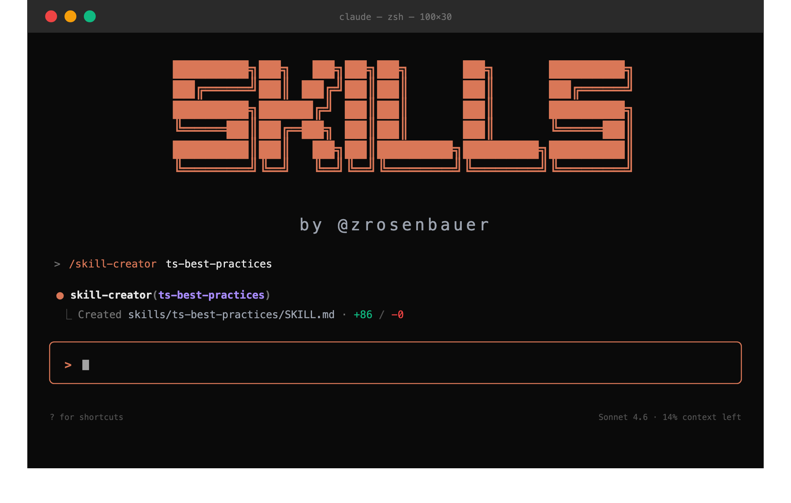

<p align="center">
  <a href="https://skills.sh/zrosenbauer/skills"></a>
  <a href="./LICENSE"></a>
</p>

A curated collection of [agent skills](https://skills.sh) for AI coding assistants — TypeScript reviews, refactors, skill authoring, and cross-agent portability.

Skills are `SKILL.md` files that tell an AI agent **when** and **how** to do something. They're agent-agnostic — drop them into Claude Code, Cursor, Codex, or any tool that supports the [skills.sh](https://skills.sh) format.

## Install

```bash
# every skill
npx skills add zrosenbauer/skills

# just one
npx skills add zrosenbauer/skills --skill ts-best-practices
```

The [`skills` CLI](https://www.npmjs.com/package/skills) handles discovery and placement for your agent.

### OpenCode slash commands

Every skill has a matching OpenCode command: `/code-reviewer`, `/live-debug`, `/npm-namer`,
`/orca-doctor`, `/skill-creator`, `/skill-portability`, `/skill-reviewer`,
`/svg-creator`, `/ts-best-practices`, `/ts-best-practices-functional`, and `/persona`.
Commands load the skill by ID and forward your arguments; they do not duplicate
its instructions or pin an agent/model.

In this checkout, commands and skill discovery are already configured:

```text
/code-reviewer staged changes
/svg-creator a banner for this project
/persona klingon intensity=3
```

For other projects, install the skills with the CLI above, then run the helper
from this checkout to install the wrappers globally:

```bash
node /path/to/skills/skill-scripts/opencode-commands.mjs --global
```

Or run it from a project's root without `--global` for project-local commands.
Use `--source /path/to/installed/skills` to generate commands for a different
skill collection. The helper needs only Node, preserves custom commands, and
does not install skills. Installing skills alone does not install these wrappers.
OpenCode reloads commands automatically; `/reload` forces a refresh.

Maintainers: `pnpm commands:opencode` regenerates the committed wrappers;
`pnpm commands:opencode --check` detects drift in CI. The commit hook regenerates
and stages them automatically.

## Skills

<details>
<summary><code>/code-reviewer</code></summary>

Adversarial review of a diff or PR — finds real issues, not nits.

[View skill](./skills/code-reviewer)

</details>

<details>
<summary><code>/ts-best-practices</code></summary>

Write or refactor TypeScript with idiomatic patterns.

[View skill](./skills/ts-best-practices)

</details>

<details>
<summary><code>/ts-best-practices-functional</code></summary>

Refactor TypeScript toward functional patterns — Result types, no mutation.

[View skill](./skills/ts-best-practices-functional)

</details>

<details>
<summary><code>/skill-creator</code></summary>

Author a new skill with naming and description rules baked in.

[View skill](./skills/skill-creator)

</details>

<details>
<summary><code>/skill-portability</code></summary>

Check whether a skill works across Claude Code, Cursor, Codex, and other agents.

[View skill](./skills/skill-portability)

</details>

<details>
<summary><code>/skill-reviewer</code></summary>

Review skill instructions and reference quality.

[View skill](./skills/skill-reviewer)

</details>

<details>
<summary><code>/npm-namer</code></summary>

Find available npm names and check collisions.

[View skill](./skills/npm-namer)

</details>

<details>
<summary><code>/svg-creator</code></summary>

Create, preview, and convert SVG assets.

[View skill](./skills/svg-creator)

</details>

<details>
<summary><code>/orca-doctor</code></summary>

Inspect Orca worktrees and recovery candidates.

[View skill](./skills/orca-doctor)

</details>

<details>
<summary><code>/persona</code></summary>

Thirteen conversational voices, from Vulcan to consensual Roast.

[View skill](./skills/persona)

</details>

<details>
<summary><code>/live-debug</code></summary>

Tracked dev servers, guarded shutdown, and workspace-aware browser debugging.

[View skill](./skills/live-debug)

</details>

Each skill ships its own `SKILL.md` under [`skills/<name>/`](./skills).

> **Discover more skills** → browse the leaderboard at [skills.sh](https://skills.sh) — top-installed agent skills across the ecosystem (vercel-labs, anthropics, microsoft, remotion, …).

## Contributing

Want to add a skill, fix a bug, or fork one for your own use? See [CONTRIBUTING.md](./CONTRIBUTING.md) for the dev setup, skill authoring workflow, and conventions.

[Behavioral evaluations](contributing/evaluations.md) run real agent CLI calls
from Promptfoo YAML (`pnpm eval:skills`).

## License

[MIT](./LICENSE) © Zac Rosenbauer
