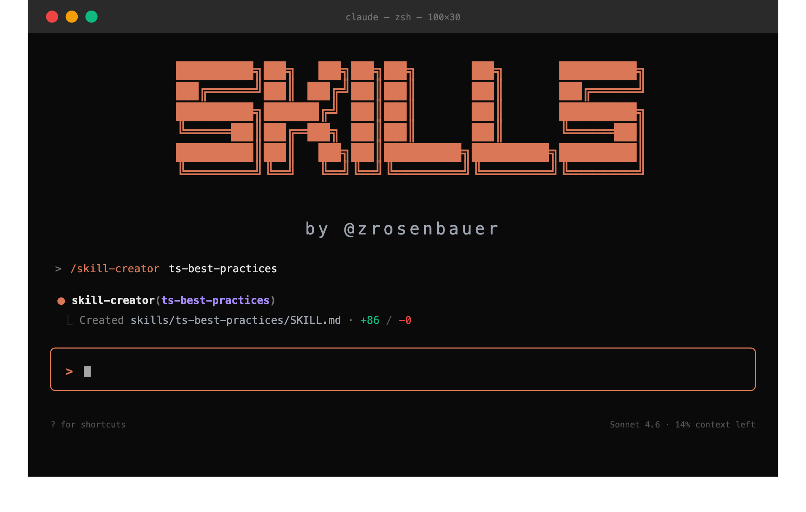

<p align="center">
  <a href="https://skills.sh/zrosenbauer/skills"></a>
  <a href="./LICENSE"></a>
</p>

A curated collection of [agent skills](https://skills.sh) for AI coding assistants — TypeScript reviews, refactors, skill authoring, and cross-agent portability.

Skills are `SKILL.md` files that tell an AI agent **when** and **how** to do something. They're agent-agnostic — drop them into Claude Code, Cursor, Codex, or any tool that supports the [skills.sh](https://skills.sh) format.

## Install

```bash
# every skill
npx skills add zrosenbauer/skills

# just one
npx skills add zrosenbauer/skills --skill ts-best-practices
```

The [`skills` CLI](https://www.npmjs.com/package/skills) handles discovery and placement for your agent.

### OpenCode slash commands

Every skill has a matching OpenCode command: `/code-reviewer`, `/npm-namer`,
`/orca-doctor`, `/skill-creator`, `/skill-portability`, `/skill-reviewer`,
`/svg-creator`, `/ts-best-practices`, and `/ts-best-practices-functional`.
Commands load the skill by ID and forward your arguments; they do not duplicate
its instructions or pin an agent/model.

In this checkout, commands and skill discovery are already configured:

```text
/code-reviewer staged changes
/svg-creator a banner for this project
```

For other projects, install the skills with the CLI above, then run the helper
from this checkout to install the wrappers globally:

```bash
node /path/to/skills/skill-scripts/opencode-commands.mjs --global
```

Or run it from a project's root without `--global` for project-local commands.
Use `--source /path/to/installed/skills` to generate commands for a different
skill collection. The helper needs only Node, preserves custom commands, and
does not install skills. Installing skills alone does not install these wrappers.
OpenCode reloads commands automatically; `/reload` forces a refresh.

Maintainers: `pnpm commands:opencode` regenerates the committed wrappers;
`pnpm commands:opencode --check` detects drift in CI. The commit hook regenerates
and stages them automatically.

## Skills

| #   | Skill                                                                   | What it does                                                           |
| --- | ----------------------------------------------------------------------- | ---------------------------------------------------------------------- |
| 1   | [`code-reviewer`](./skills/code-reviewer)                               | Adversarial review of a diff or PR — finds real issues, not nits       |
| 2   | [`ts-best-practices`](./skills/ts-best-practices)                       | Writing or refactoring TypeScript with idiomatic patterns              |
| 3   | [`ts-best-practices-functional`](./skills/ts-best-practices-functional) | Refactoring TS toward functional patterns — Result types, no mutation  |
| 4   | [`skill-creator`](./skills/skill-creator)                               | Authoring a new skill with naming + description rules baked in         |
| 5   | [`skill-portability`](./skills/skill-portability)                       | Checking whether a skill works across Claude Code, Cursor, Codex, etc. |
| 6   | [`skill-reviewer`](./skills/skill-reviewer)                             | Reviewing skill instructions and reference quality                     |
| 7   | [`npm-namer`](./skills/npm-namer)                                       | Finding available npm names and checking collisions                    |
| 8   | [`svg-creator`](./skills/svg-creator)                                   | Creating, previewing, and converting SVG assets                        |
| 9   | [`orca-doctor`](./skills/orca-doctor)                                   | Inspecting Orca worktrees and recovery candidates                      |

Each skill ships its own `SKILL.md` under [`skills/<name>/`](./skills).

> **Discover more skills** → browse the leaderboard at [skills.sh](https://skills.sh) — top-installed agent skills across the ecosystem (vercel-labs, anthropics, microsoft, remotion, …).

## Contributing

Want to add a skill, fix a bug, or fork one for your own use? See [CONTRIBUTING.md](./CONTRIBUTING.md) for the dev setup, skill authoring workflow, and conventions.

## License

[MIT](./LICENSE) © Zac Rosenbauer
